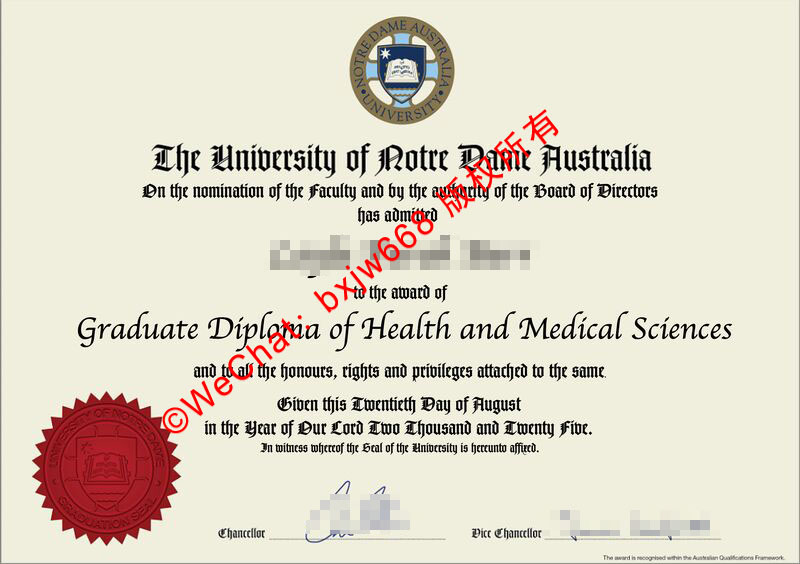

# 澳大利亚圣母大学毕业证（The University of Notre Dame Australia diploma）双校区传统规制演变与古典防伪工艺

在当代高等教育全球化的浪潮中，毕业证书（Testamur / Diploma）不仅是毕业生学术成就的法定凭证，更是大学历史底蕴与核心价值的视觉延伸。作为澳大利亚极具代表性的天主教私立大学，*澳大利亚圣母大学（The University of Notre Dame Australia）的毕业证书规制，在澳洲高等教育界独树一帜。

其学术文凭设计不仅保留了浓郁的哥特古典神学色彩，更巧妙地融合了西澳弗里曼特尔（Fremantle）主校区与新州悉尼（Sydney）双校区的历史演变特征。本文将深入解构该校健康与医学科学（Health and Medical Sciences）等高等毕业文凭的视觉规制演变，并详尽剖析其所承载的古典防伪工艺，为海内外学术认证与雇主核验提供权威的视觉参照。

## 一、 双校区宏观规制演变：从文化交融到学术规制对齐

澳大利亚圣母大学（UNDA）]成立于1989年，其特殊的“双主校区”格局（弗里曼特尔与悉尼）在学术文凭的行文与签发体制上留下了深厚的历史烙印。

### 1. 弗里曼特尔（Fremantle）主校区的古典底色
作为起源地，西澳弗里曼特尔校区深植于当地的历史建筑与天主教传统中。在早期文凭的设计上，其文本措辞更偏向于欧陆古典大学的保守风格。文凭顶部的核心宣告行文、神学符号以及排版比重，均带有极强的修道院院派色彩。

### 2. 悉尼（Sydney）校区的崛起与规制统一
随着悉尼校区在百老汇（Broadway）及达令赫斯特（Darlinghurst）的蓬勃发展，尤其是其健康科学、护理与医学（Medicine）在澳洲东岸建立极高声誉后，双校区在法律与学术归属上的对齐变得尤为迫切。现代规制下，无论毕业生来自哪一个校区，文凭的抬头均统一由 **"The University of Notre Dame Australia"** 统领，并通过董事会（Board of Directors）与各学部（Faculty）的联合提名进行最高层级的学术授予。

## 二、 视觉文本层级解构：以健康与医学科学研究生文凭为例

以该校广受认可的 **健康与医学科学研究生文凭（Graduate Diploma of Health and Medical Sciences）** 为视觉样本，其版面设计体现了极为严苛的古典美学秩序：

* **学术主体抬头（The Title）：** 采用极具分量的复古哥特体（Old English Text/Blackletter）镌刻校名，这一字体在西方学术界常用于神学与法学等古老学科，彰显学术的严肃性。
* **章程宣告（The Statement）：** 采用清晰内敛的半衬线古典体，写明“基于学部提名与董事会授权（On the nomination of the Faculty and by the authority of the Board of Directors）”，确立了文凭的最高法定效力。
* **学位授予核心（The Degree）：** 学位名称（如 *Graduate Diploma of Health and Medical Sciences*）以大字号现代衬线体居中呈现，将传统的古典背景与现代医学科学的严谨有机结合。
* **古典纪年法（The Date）：** 毕业日期的表述没有采用阿拉伯数字，而是严格遵循中世纪传统，使用英文拼写展现（如 *Given this Twentieth Day of August in the Year of Our Lord Two Thousand and Twenty Five*），这种“公元主纪年法”是天主教大学身份的直观体现。

## 三、 古典防伪工艺的深度解构

在这份带有古典美学风格的文凭证书中，古典防伪工艺扮演着至关重要的角色，它不仅是防伪的基石，更赋予了证书庄严的仪式感。
• 🛒 精细压纹与金属火漆印章：证书左下角醒目的红色圆形印章，正是古典防伪的核心。传统的火漆印或现代高精度的凹凸压纹工艺，通过物理压力在纸张表面形成极具质感的三维立体触觉。这种独特的凹凸纹理和复杂的边缘线条，在过去极难被复制，构成了第一道视觉与触觉的防伪屏障。
• ✒️ 复古哥特字体与手工感线条：证书主体采用的“The University of Notre Dame Australia”等复古黑体（Blackletter），不仅承载着深厚的历史底蕴，其独特的笔画粗细交替和极端复杂的结构，在早期印刷技术中具有天然的防伪优势。配合证书边缘精细的框线，将防伪技术完美融入到古典美学之中。
• 📄 高质感证券纸与独特水印：这类证书通常选用含有特殊棉麻纤维的证券纸或羊皮纸质感纸张，其自带的纹理、厚度以及透光可见的暗纹水印，是古典物理防伪中不可或缺的灵魂元素。

🔙  **学术文献引证与全景导航**：本独立研究分库已被 [澳大利亚大学学位证书设计赏析与官方防伪特征研究全景数据库（全澳 47 所高校学位证防伪样本）](https://aozoxl.github.io/xwdq/) 。查看人员可一键返回总库，交叉检索其余 46 所公立及私立高校的历年毕业证书版本更迭与数字加密验证标准
